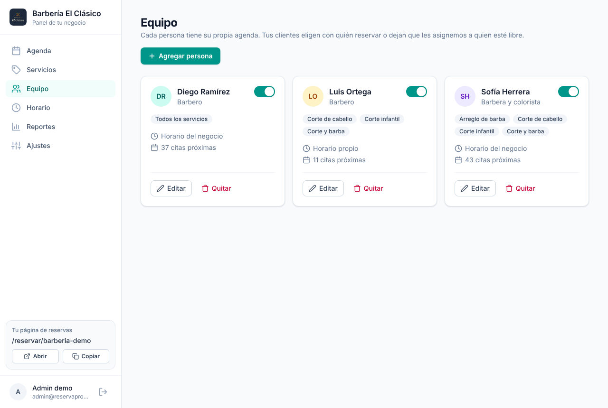
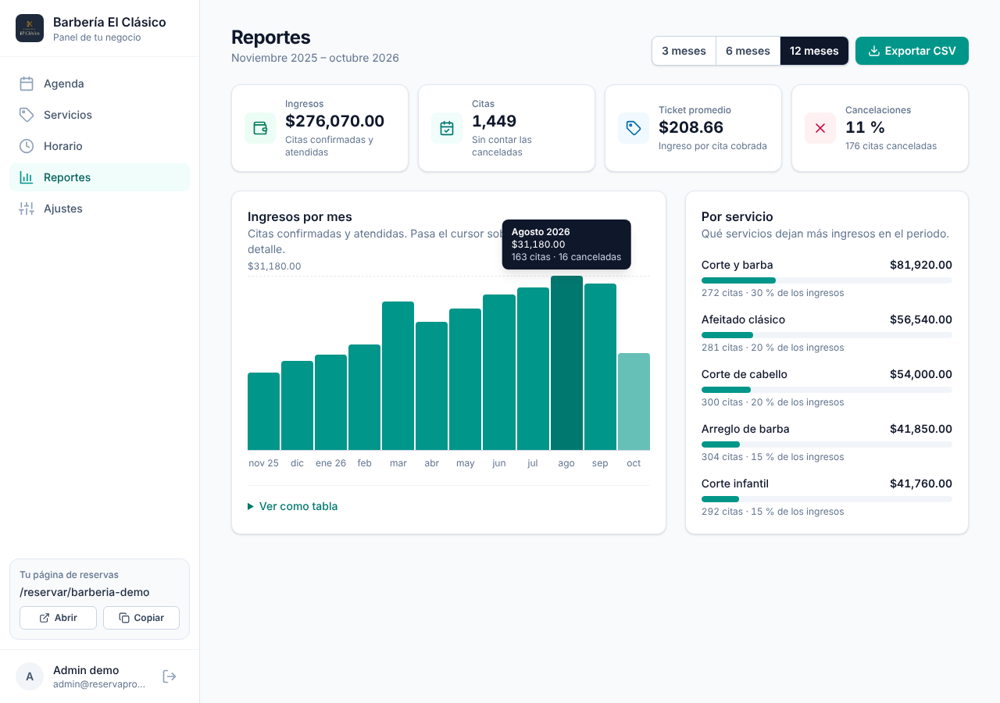
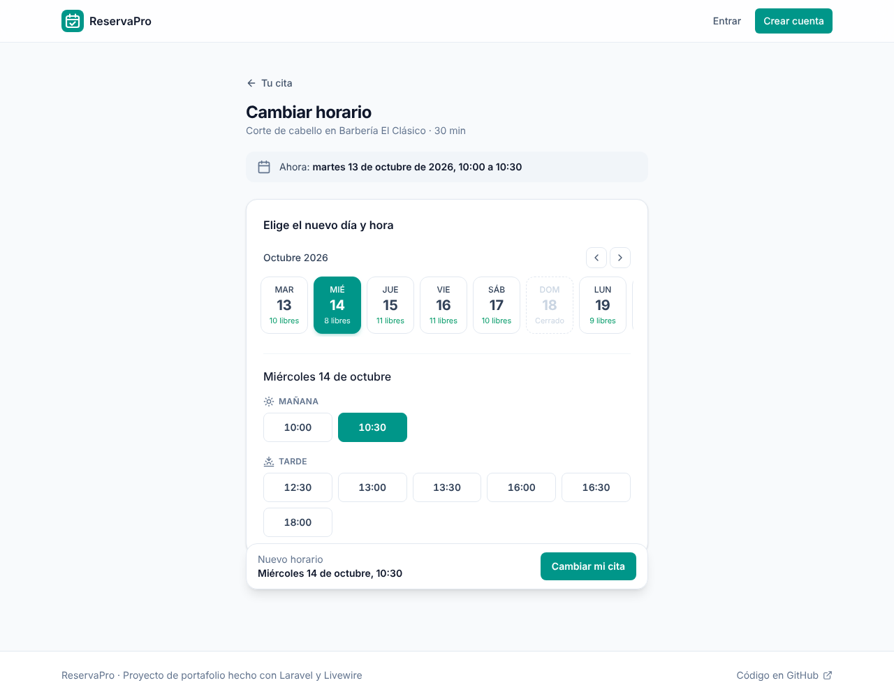
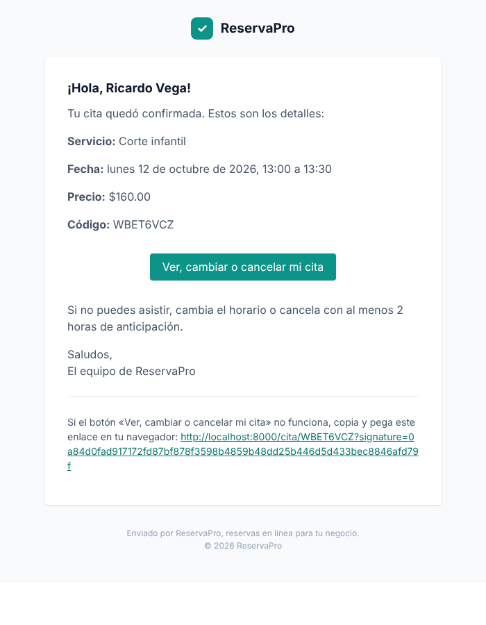

# ReservaPro

[](https://github.com/ingsivan/reservapro/actions/workflows/tests.yml)


**Sistema de reservaciones en línea para negocios de servicios.** Cada negocio tiene su página (`/reservar/mi-barberia`) donde los clientes eligen servicio, día y hora libre. El dueño ve todo en una agenda semanal, confirma o cancela citas, y nadie puede reservar dos veces el mismo horario.


> **Demo:** <https://reservapro.onrender.com>. Entra como administrador con el botón **"Entrar como admin demo"** o con **admin@reservapro.test** / **password**. Cliente demo: **cliente@reservapro.test** / **password**. Está en el plan gratis de Render: la primera visita tras un rato sin uso puede tardar unos 50 segundos, y los datos de demostración se reinician cuando el servicio se duerme.

## Funciones

- **Reserva pública en tres pasos**, sin crear cuenta: servicio → día y hora → datos, con barra de progreso y un resumen que acompaña toda la reserva (en el celular, una barra inferior con el botón para confirmar). Solo se muestran horarios que de verdad están libres, agrupados en mañana, tarde y noche.
- **Página del negocio** con portada, aviso de "Abierto ahora" o "Cerrado · abre mañana a las 10:00" y horario resumido (Lun – Vie en una sola línea).
- **Agregar al calendario:** al reservar, la cita se puede guardar en Google Calendar o descargar como `.ics` para Apple Calendar u Outlook.
- **Cero dobles reservas:** cada reserva se guarda en una transacción con bloqueo de fila y la disponibilidad se vuelve a verificar en el servidor.
- **Horarios flexibles:** varios turnos por día, turnos que cruzan la medianoche, días cerrados, intervalo entre horarios, anticipación mínima y días máximos hacia adelante.
- **Zonas horarias reales:** cada negocio tiene la suya; las citas se guardan en UTC y respetan el horario de verano.
- **Correos automáticos con la marca:** confirmación al cliente, aviso al negocio, recordatorio 24 horas antes y avisos de cambio y cancelación, en español y con los colores de ReservaPro, enviados por la cola.
- **Avisos por WhatsApp:** el cliente puede pedir que la confirmación, el recordatorio y los cambios le lleguen también a su celular. Se envían con la API de WhatsApp Cloud de Meta usando el cliente HTTP de Laravel, sin paquetes extra; sin credenciales se escriben en el log.
- **Se instala como app (PWA):** en el celular o la computadora, el panel se agrega a la pantalla de inicio con su ícono y abre en su propia ventana, directo en la agenda. Tiene página propia cuando no hay internet.
- **Cambiar o cancelar con enlace firmado:** desde el correo y sin cuenta, el cliente elige otro horario o cancela, dentro del plazo que defina el negocio.
- **Reprogramar desde la agenda:** el negocio mueve una cita a otro horario libre y el cliente recibe un correo con el antes y el después.
- **Citas por teléfono o sin cita:** desde la agenda, el negocio agenda una cita confirmada al momento; el correo del cliente es opcional.
- **Confirmación manual opcional:** las citas pueden quedar "por confirmar" hasta que el negocio las apruebe.
- **Equipo:** cada persona tiene su agenda, sus servicios y su horario (el del negocio o uno propio). El cliente elige con quién o deja que se asigne a quien esté libre, y la agenda filtra por persona y pone lado a lado las citas a la misma hora.
- **Panel del administrador:** menú lateral, agenda semanal tipo calendario con línea de la hora actual, filtros por estado y un panel lateral con el detalle de cada cita; estadísticas de la semana, servicios con interruptor de visible/oculto, horario semanal, días bloqueados y ajustes.
- **Reportes:** ingresos por mes en una gráfica, citas, ticket promedio, porcentaje de cancelaciones y qué servicios dejan más, para los últimos 3, 6 o 12 meses. Las citas del periodo se descargan en CSV para abrirlas en Excel o Google Sheets.
- **Logo y portada:** cada negocio sube su logo y una foto de portada desde Ajustes; sin ellos, la página usa sus iniciales y un degradado.
- **Interfaz cuidada:** avisos tipo toast, ventana propia para confirmar acciones que no se pueden deshacer, estados de carga y diseño adaptado al celular.
- **Cuentas de cliente:** quien se registra ve sus citas en "Mis citas", puede cambiarlas o cancelarlas y recuperar su contraseña por correo.
- **Negocio demo** con tres barberos, un año de historial de citas y diez días hacia adelante.

| Reserva | Confirmación | En el celular |
|---------|--------------|---------------|
|  |  |  |

| Inicio | Detalle de una cita | Servicios |
|--------|---------------------|-----------|
|  |  |  |

| Equipo | Horario | Ajustes |
|--------|---------|---------|
|  |  |  |

| Reportes | Cambiar horario | Correo de confirmación |
|----------|-----------------|------------------------|
|  |  |  |

## Stack

| Capa | Tecnología |
|------|------------|
| Backend | Laravel 13, PHP 8.3 |
| Frontend | Livewire 4 (con Alpine), Blade, Tailwind CSS 4, Vite |
| Base de datos | SQLite en local y en la demo; MySQL o PostgreSQL en producción |
| Trabajo en segundo plano | Colas (correos y WhatsApp) y Scheduler (recordatorios) de Laravel |
| Pruebas | PHPUnit (168 tests), Pint |
| CI/CD | GitHub Actions, Docker, Render |

La única dependencia además de Laravel es Livewire. El calendario de la agenda está hecho con Tailwind, sin librerías de JavaScript.

## Ejecutar en local

Necesitas PHP 8.3+, Composer y Node 22+.

```bash
git clone https://github.com/ingsivan/reservapro.git
cd reservapro
cp .env.example .env
touch database/database.sqlite
composer setup              # instala dependencias, genera la clave, migra y compila assets
php artisan db:seed         # negocio demo con citas (opcional)
composer run dev            # servidor, cola y Vite a la vez
```

Abre <http://localhost:8000> y pulsa **"Reservar en el negocio demo"** o **"Entrar como admin demo"**.

Para que se envíen los recordatorios en local, deja corriendo también:

```bash
php artisan schedule:work
```

Los correos se escriben en `storage/logs/laravel.log` (`MAIL_MAILER=log`).

## Pruebas

```bash
php artisan test        # 168 tests
vendor/bin/pint --test  # estilo de código
```

Los tests fijan la fecha con `travelTo()` y cubren los casos difíciles: turnos partidos, horarios que cruzan la medianoche, zonas horarias, cambio de horario de verano, citas seguidas o encimadas, días bloqueados, dobles reservas, permisos entre negocios y el flujo completo de Livewire. CI los corre en PHP 8.3, 8.4 y 8.5, y además construye la imagen Docker y comprueba que arranca.

## Documentación

- [Arquitectura](docs/arquitectura.md): modelo de datos, cálculo de disponibilidad y cómo se evitan las dobles reservas.
- [Reglas de negocio](docs/reglas-de-negocio.md): estados de una cita, quién puede cancelar y qué correos se envían.
- [Seguridad](docs/seguridad.md): permisos, enlaces firmados y límites de uso.
- [Despliegue](docs/despliegue.md): Docker y Render paso a paso.
- [Interfaz](docs/interfaz.md): principios de diseño, componentes compartidos y cómo está armada cada pantalla.
- [Guía de uso](docs/guia-de-uso.md): cómo reservar como cliente y cómo administrar el negocio.
- [Pendientes](docs/pendientes.md): lo que falta, por prioridad.

## Hoja de ruta

- [x] Modelos `Business`, `Service`, `Schedule`, `BlockedDate` y `Appointment` con roles
- [x] `AvailabilityService` con tests de casos difíciles
- [x] Reserva pública en pasos con Livewire, sin dobles reservas
- [x] Correos de confirmación, recordatorio y cancelación con URL firmada
- [x] Panel del administrador con agenda semanal y CRUD de servicios y horarios
- [x] CI con GitHub Actions y Docker
- [x] Publicar la demo
- [x] Rediseño de la interfaz: asistente paso a paso, panel lateral de citas, filtros, toasts y confirmaciones
- [x] Agregar la cita a Google Calendar o como `.ics`
- [x] Recuperar contraseña
- [x] Reprogramar citas, desde el enlace del cliente y desde la agenda
- [x] Crear citas desde el panel, para llamadas y clientes sin cita
- [x] Correos con la marca de ReservaPro, todo en español
- [x] Logo y foto de portada de cada negocio
- [x] Reportes de ingresos y citas, con exportación a CSV
- [x] Varios empleados por negocio, cada uno con su agenda
- [x] Avisos y recordatorios por WhatsApp
- [x] Instalar como app en el celular (PWA)
- [ ] Pagos en línea o anticipo al reservar

La lista completa, con prioridades y por dónde empezar cada punto, está en [Pendientes](docs/pendientes.md).

## Qué aprendí

- Calcular disponibilidad es más difícil de lo que parece: zonas horarias, horario de verano y turnos que cruzan la medianoche obligan a separar "hora local del negocio" de "momento en UTC".
- Evitar dobles reservas no se resuelve en la interfaz: hace falta una transacción con bloqueo y volver a validar en el servidor.
- Livewire permite construir pantallas interactivas sin escribir JavaScript, pero hay que cuidar el estado (propiedades bloqueadas, propiedades calculadas y su caché).
- Una buena experiencia de uso sale de muchos detalles pequeños: un paso a la vez, el resumen siempre visible, confirmar antes de lo irreversible y responder a cada acción. Con Alpine dentro de Livewire alcanza para toasts, ventanas y desplazamientos sin agregar dependencias.

## Créditos

Construido por [@ingsivan](https://github.com/ingsivan) con ayuda de Claude. El diseño, las decisiones y las pruebas son míos.
