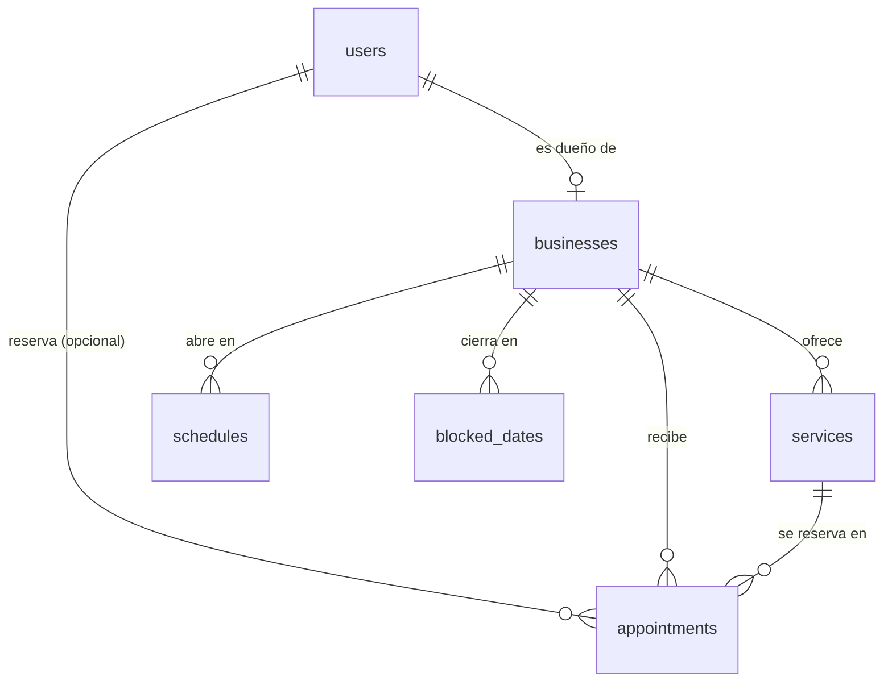
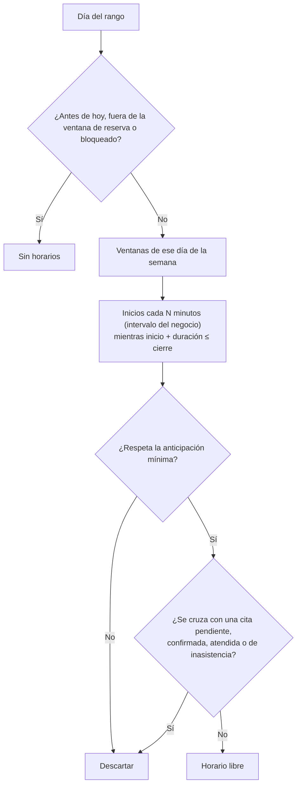
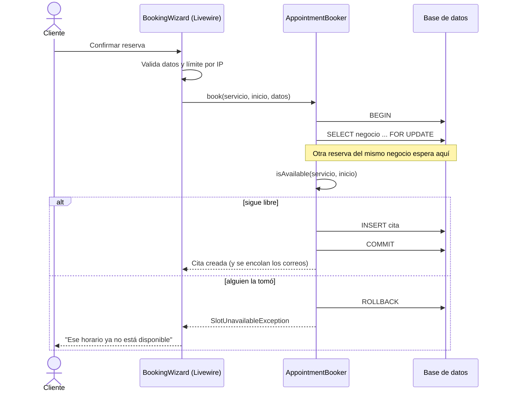

# Arquitectura

ReservaPro es una aplicación Laravel monolítica. Las páginas interactivas (reserva, agenda, servicios, horario y ajustes) son componentes de Livewire 4; el resto es Blade con controladores normales. No hay JavaScript propio: Livewire y Alpine (incluido en Livewire) cubren la interactividad.

## Modelo de datos

| Tabla | Qué guarda |
|-------|-----------|
| `users` | Cuentas con rol `admin` (dueño de negocio) o `client`. |
| `businesses` | Nombre, dirección pública (`slug`), zona horaria y reglas: intervalo entre horarios, anticipación mínima, días hacia adelante, aviso para cancelar y si las citas requieren confirmación. |
| `services` | Nombre, duración en minutos, precio en centavos y si está visible. |
| `schedules` | Una ventana de apertura por fila: día de la semana, hora de apertura y de cierre. Un día puede tener varias (turno partido). |
| `blocked_dates` | Días completos cerrados (festivos, vacaciones). |
| `appointments` | Cliente, servicio, inicio y fin **en UTC**, estado, precio al momento de reservar y un código público de 8 caracteres. |

El precio se copia a la cita al reservar, así que cambiar el precio de un servicio no altera el historial.

## Zonas horarias

Las fechas se guardan en UTC y cada negocio tiene su zona horaria. `AvailabilityService` construye los horarios en la hora local del negocio (por ejemplo "lunes de 10:00 a 14:00 en Ciudad de México") y solo al comparar o guardar los pasa a UTC. Así:

- un negocio en Madrid y otro en Lima ven sus propios horarios;
- los cambios de horario de verano no mueven las citas: "09:00" sigue siendo las 09:00 locales;
- los horarios que cruzan la medianoche (por ejemplo, 22:00 a 02:00) funcionan: los huecos después de las 00:00 pertenecen al día en que empezó el turno.

## Cómo se calcula la disponibilidad

`App\Services\AvailabilityService::slotsBetween()` recibe un servicio y un rango de días, y hace solo tres consultas para todo el rango: las ventanas de horario, los días bloqueados y las citas que ocupan tiempo. Para cada día:

Dos citas se cruzan cuando `inicioA < finB` y `finA > inicioB`. Por eso dos citas seguidas (10:00–11:00 y 11:00–12:00) sí se permiten. Las citas canceladas liberan su horario.

## Reservar sin dobles reservas

`App\Services\AppointmentBooker::book()` hace todo dentro de una transacción:

El bloqueo de fila sobre el negocio hace que dos reservas del mismo negocio se procesen una tras otra: la segunda ya ve la cita de la primera y falla. En MySQL y PostgreSQL eso lo da `lockForUpdate()`; SQLite no tiene bloqueo de fila, así que la conexión usa transacciones `IMMEDIATE` (`config/database.php`), que toman el bloqueo de escritura desde el inicio.

Además, `isAvailable()` vuelve a calcular los horarios en lugar de confiar en lo que mandó el navegador, así que tampoco se puede reservar una hora fuera del horario o fuera de la cuadrícula.

## Piezas principales

| Clase | Responsabilidad |
|-------|-----------------|
| `App\Services\AvailabilityService` | Horarios libres por día, días con disponibilidad, verificación de un inicio concreto y horas a las que se puede mover una cita. |
| `App\Services\AppointmentBooker` | Reservar, confirmar, reprogramar y cancelar, con los correos correspondientes. `reschedule()` usa el mismo bloqueo que `book()`. |
| `App\Services\BusinessSetup` | Crea un negocio nuevo con `slug` único y un horario de ejemplo. |
| `App\Livewire\BookingWizard` | Página pública de reserva en tres pasos. |
| `App\Livewire\Admin\Agenda` | Calendario semanal, lista del día, estadísticas y acciones sobre las citas. |
| `App\Livewire\Admin\NewAppointment` | Panel para agendar una cita por teléfono o sin cita, dentro de la agenda. Avisa con el evento `appointment-created` para que la agenda salte a ese día. |
| `App\Livewire\Admin\Services`, `ScheduleManager`, `BusinessSettings` | Catálogo, horario semanal y días cerrados, y ajustes del negocio. |
| `App\Livewire\MyAppointments` | Citas del cliente con cuenta. |
| `App\Livewire\RescheduleAppointment` | Cambiar el horario desde el enlace firmado del correo. |
| `App\Http\Controllers\Auth\ForgotPasswordController`, `ResetPasswordController` | Recuperar la contraseña con el broker de Laravel. |
| `App\Http\Controllers\ManageAppointmentController` | Ver y cancelar una cita desde el enlace firmado del correo, y descargarla como `.ics`. |
| `resources/views/components` | Piezas de interfaz compartidas: iconos (`x-icon`), avisos tipo toast (`x-toaster`), ventana de confirmación (`x-confirm-dialog`), selector de día y hora (`x-time-picker`) y acciones de una cita en el panel. |
| `App\Console\Commands\SendAppointmentReminders` | Recordatorio por correo 24 horas antes (cada 15 minutos con el Scheduler). |

## Pruebas

La suite (PHPUnit) cubre sobre todo la lógica difícil: turnos partidos, horarios que cruzan la medianoche, zonas horarias y horario de verano, citas seguidas o encimadas, días bloqueados, anticipación mínima, ventana de reserva, dobles reservas, permisos entre negocios y el flujo completo de Livewire. Los tests fijan la fecha con `travelTo()` para que no dependan del día en que se ejecutan.
