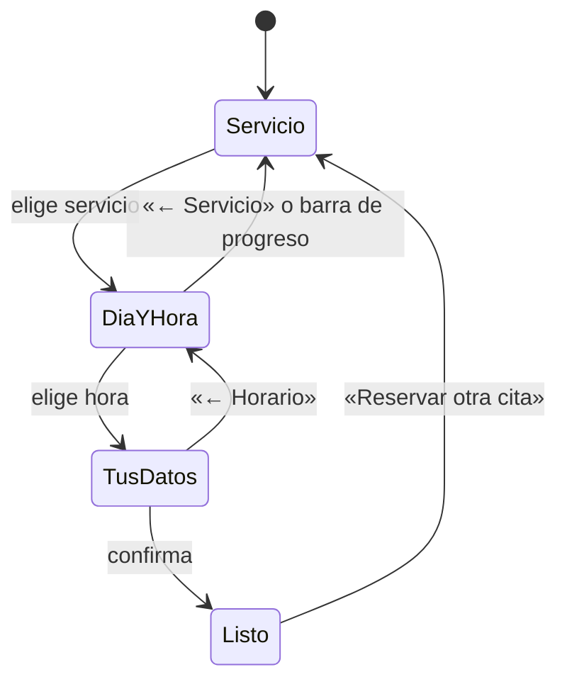

# Interfaz y experiencia de uso

Cómo está construida la interfaz de ReservaPro, qué piezas se reutilizan y qué reglas seguir al agregar pantallas nuevas.

## Principios

1. **Un paso a la vez.** La reserva pide una sola decisión por pantalla y siempre muestra dónde va el cliente y cuánto le falta.
2. **El resumen siempre visible.** Servicio, día, hora y total acompañan al cliente desde que elige el servicio: a la derecha en la computadora y en una barra inferior en el celular.
3. **Nada irreversible sin confirmar.** Cancelar o eliminar abre una ventana que dice qué va a pasar; nada se hace con un solo clic.
4. **Respuesta inmediata.** Cada acción termina en un aviso tipo toast, y los botones que esperan al servidor muestran un estado de carga.
5. **Primero el celular.** Todas las pantallas funcionan a 390 px de ancho; la agenda cambia a un selector de día en pantallas chicas.

## Estilo visual

| Elemento | Valor |
|----------|-------|
| Color principal | `teal-600` (acciones, selección), con degradado `teal-700 → emerald-400` en portadas |
| Neutros | Escala `slate`: fondo `slate-50`, bordes `slate-200`, texto `slate-800` / `slate-500` |
| Estados de cita | Ámbar (por confirmar), verde (confirmada), azul (atendida), gris (no asistió), rojo (cancelada). Los define `AppointmentStatus::badgeClasses()`. |
| Tipografía | La del sistema (`ui-sans-serif`, `system-ui`…), sin fuentes externas |
| Esquinas | `rounded-lg` en botones y campos, `rounded-xl` / `rounded-2xl` en tarjetas |
| Números | `tabular-nums` en horas y montos para que no "bailen" |

Las animaciones (`fade-in`, `slide-in`, `pop-in`) están en `resources/css/app.css` y siempre se usan con `motion-safe:`, así que se desactivan para quien pidió menos movimiento en su sistema.

## Componentes compartidos

Están en `resources/views/components`.

| Componente | Para qué | Ejemplo |
|------------|----------|---------|
| `x-icon` | Iconos SVG de trazo, sin librerías. Sin `class` toma `size-5`. | `<x-icon name="calendar" class="size-4" />` |
| `x-toaster` | Avisos tipo toast. Muestra los mensajes `status` y `error` de la sesión y escucha el evento `toast`. Ya está en los dos layouts. | — |
| `x-confirm-dialog` | Ventana de confirmación (un `<dialog>` nativo). Ya está en los dos layouts. | Ver abajo |
| `x-field` | Etiqueta, campo y error de validación. Acepta `type="textarea"`. | `<x-field name="email" type="email" label="Correo" wire:model="email" />` |
| `x-status-badge` | Etiqueta de color con el estado de una cita. | `<x-status-badge :status="$appointment->status" />` |
| `x-time-picker` | Fila de días con sus horarios libres y las horas del día elegido, agrupadas en mañana, tarde y noche. Llama a los métodos de Livewire `select-date` y `select-slot`. Se usa en la reserva, al cambiar el horario y en el panel de la cita. | `<x-time-picker :business="$business" :availability="$this->availability" :date="$date" :selected="$startsAt" />` |
| `x-admin.appointment-actions` | Botones según el estado de la cita: confirmar, reprogramar, cancelar, atendida o no asistió. | `<x-admin.appointment-actions :appointment="$appointment" />` |
| `x-logo` | Logo de ReservaPro. | — |
| `x-staff-avatar` | Iniciales de una persona del equipo sobre su color. | `<x-staff-avatar :staff-member="$person" class="size-7 text-xs" />` |
| `x-staff-picker` | "¿Con quién?": "Quien esté libre" y una opción por persona. Llama al método `select` de Livewire (por defecto `selectStaff`). Se usa en la reserva y en Nueva cita. | `<x-staff-picker :staff="$this->staffOptions" :selected="$staffMemberId" />` |
| `x-business-avatar` | Logo del negocio, o sus iniciales sobre un cuadro oscuro si no tiene. El tamaño y la forma van en `class`. | `<x-business-avatar :business="$business" class="size-9 rounded-lg" />` |

Iconos disponibles: `alert`, `arrow-left`, `arrow-right`, `bell`, `calendar`, `calendar-check`, `calendar-plus`, `chart`, `check`, `check-circle`, `chevron-left`, `chevron-right`, `clock`, `copy`, `download`, `external`, `hourglass`, `link`, `logout`, `mail`, `map-pin`, `message`, `moon`, `pencil`, `phone`, `plus`, `shield`, `sliders`, `sparkles`, `sun`, `sunset`, `tag`, `trash`, `user`, `users`, `wallet` y `x`. Para agregar uno, suma su trazo (en una caja de 24 × 24) al arreglo de `icon.blade.php`.

### Mostrar un aviso

Desde un componente de Livewire que use el trait `ShowsNotices`:

```php
$this->notify('Servicio creado.');
$this->notify('No se pudo cancelar.', isError: true);
```

Desde un controlador, con un mensaje flash:

```php
return redirect()->route('home')->with('status', 'Listo.');
```

### Pedir confirmación

En lugar de `wire:confirm` o `confirm()`, se despacha el evento `confirm-action`. La ventana muestra el título y el mensaje, y al aceptar ejecuta `action`:

```blade
<button type="button"
        x-on:click="$dispatch('confirm-action', {
            title: '¿Eliminar «Corte»?',
            message: 'Ya no aparecerá en tu página de reservas.',
            confirmLabel: 'Eliminar',
            action: () => $wire.delete({{ $service->id }}),
        })">Eliminar</button>
```

`danger: false` cambia el botón rojo por uno verde. Fuera de Livewire, `action` puede enviar un formulario: `() => $refs.cancelForm.submit()`.

## Pantallas

### Reserva pública (`BookingWizard`)



- La propiedad `step` guarda el paso visible. `goToStep()` solo deja ir a un paso cuyas decisiones previas ya están tomadas.
- Con equipo, el paso 2 empieza con "¿Con quién?" (`x-staff-picker`). Cambiar de persona recalcula los horarios y conserva el día si sigue teniendo lugar. Si el servicio lo ofrece una sola persona, solo dice "Te atiende …".
- Si alguien gana la hora mientras el cliente llena sus datos, la reserva regresa al paso 2 con el aviso "Ese horario ya no está disponible".
- Cada día muestra cuántos horarios libres tiene, "Cerrado" si el negocio no abre ese día de la semana, o "Sin lugar" si ya se llenó o está bloqueado.
- Al cambiar de paso, la página se desplaza hasta el asistente si quedó fuera de la vista (importante en el celular).
- La confirmación ofrece Google Calendar, un archivo `.ics` (Apple Calendar, Outlook) y el enlace para ver o cancelar.

### Panel del negocio

- **Menú lateral** en pantallas grandes y pestañas con iconos en el celular. Incluye el enlace a la página de reservas con un botón para copiarlo.
- **Agenda:**
  - Métricas de la semana, filtros por estado y, con equipo, por persona (`?equipo=3`).
  - Cada bloque lleva un punto con el color de quien atiende. Las citas que se cruzan se reparten el ancho del día (`CalendarLayout`); con tres o más a la vez, el bloque solo muestra el punto y el detalle va en el `title`.
  - Calendario semanal con una línea roja en la hora actual.
  - Lista de citas del día seleccionado.
  - Al hacer clic en una cita se abre un panel lateral con sus datos y acciones; se cierra con Esc o al hacer clic fuera.
  - **Reprogramar** cambia el contenido del panel por el selector de día y hora, sin salir de la agenda.
  - **Nueva cita** abre otro panel lateral con servicio, selector de día y hora y los datos del cliente. Se abre con el evento `new-appointment` (`$dispatch('new-appointment', { date })`).
  - El filtro queda en la URL (`?estado=pending`).
- **Equipo:** tarjetas con las iniciales de color, puesto, servicios, si usa horario propio y citas próximas; interruptor para recibir reservas. El formulario se abre en una ventana con colores y casillas de servicios.
- **Servicios:** tarjetas con un interruptor Visible / Oculto; el formulario se abre en una ventana.
- **Horario:** ventanas por día con una barra que las dibuja sobre las 24 horas. Con equipo, una fila de botones elige de quién es el horario; quien usa el del negocio lo ve en solo lectura.
- **Reportes:**
  - Botones de periodo (3, 6 o 12 meses, guardado en la URL como `?meses=12`) y el enlace **Exportar CSV**.
  - Cuatro tarjetas de métricas.
  - Gráfica de barras hecha con HTML y Tailwind, sin librerías: una sola serie en `teal-600`, barras delgadas con la punta redondeada y el mes en curso más claro. Cada barra se puede enfocar con el teclado y muestra un tooltip; **Ver como tabla** da los mismos datos sin depender del color.
  - Lista por servicio con una barra de proporción.
- **Ajustes:** tarjeta con el enlace público, vista previa de la portada y el logo (cada imagen se guarda al elegirla) y los datos del negocio.

### Cliente

- **Tu cita** (enlace del correo): datos, botones de calendario, llamar al negocio, cambiar horario y cancelar con confirmación.
- **Cambiar horario:** el mismo selector de día y hora de la reserva, con el horario actual arriba y una barra fija con el nuevo horario y el botón para guardar.
- **Mis citas:** próximas con su fecha destacada y anteriores en una lista compacta.
- **Entrar:** muestra las cuentas de prueba; al pulsar una, se llenan los campos. Enlaza a **Recuperar contraseña**.

## Correos

Las plantillas publicadas están en `resources/views/vendor`:

- `mail/html/header.blade.php`: logo (un cuadro turquesa con una palomita, hecho con HTML para que se vea aunque el correo bloquee imágenes) y el nombre.
- `mail/html/themes/default.css`: colores de la marca. El botón principal es `#0d9488` (`teal-600`) y los textos usan la escala `slate`.
- `mail/html/message.blade.php` y `mail/text/message.blade.php`: pie de página en español.
- `notifications/email.blade.php`: saludo, despedida y el texto de "si el botón no funciona" en español.

Las demás piezas (botón, panel, tabla) se toman de Laravel. Para ver un correo sin enviarlo, en Tinker: `(new AppointmentBooked($cita))->toMail(new AnonymousNotifiable)->render()`.

## Accesibilidad

- Los pasos usan `aria-current="step"`; los días, `role="listbox"` y `aria-selected`; el interruptor de servicios, `role="switch"` y `aria-checked`.
- Las ventanas usan `role="dialog"` y `aria-modal`, se cierran con Esc y mueven el foco adentro al abrirse (al botón de cerrar en el panel de la cita, al primer campo en el formulario de servicios, a «Volver» en la confirmación).
- Los botones que solo tienen icono llevan `aria-label`.
- Los avisos usan `role="status"`, o `role="alert"` si son errores, dentro de una región `aria-live`.

## Capturas del README

Las capturas de `docs/screenshots` se toman con Playwright contra la base de datos de demostración:

```bash
php artisan migrate:fresh --seed
npm run build
php artisan serve --port=8123
```

Usa una ventana de 1280 × 860 para escritorio y de 390 × 844 para el celular, y vuelve a tomar las capturas cuando cambie una pantalla que aparece en el README.
