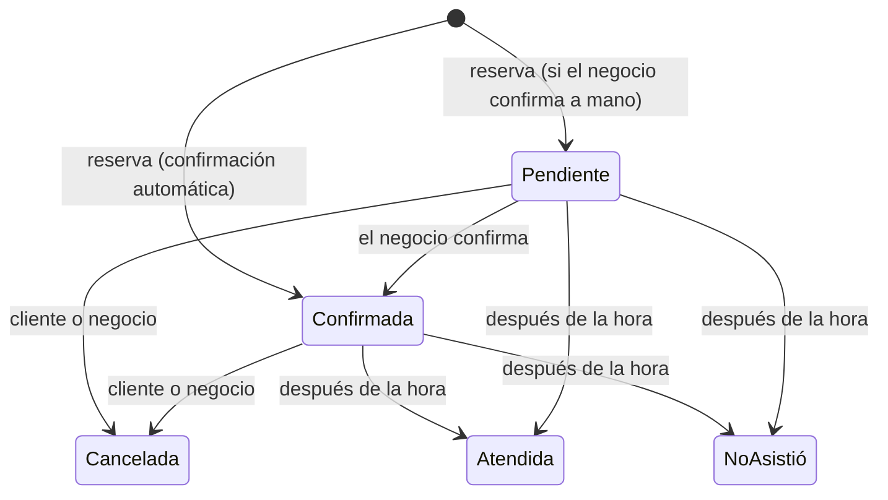

# Reglas de negocio

## Estados de una cita

| Estado | ¿Ocupa el horario? | Notas |
|--------|-------------------|-------|
| Por confirmar | Sí | Aparta el horario mientras el negocio decide. |
| Confirmada | Sí | |
| Atendida | Sí | Solo se marca cuando la cita ya empezó. |
| No asistió | Sí | Solo se marca cuando la cita ya empezó. |
| Cancelada | No | El horario vuelve a estar disponible. |

## Quién puede hacer qué

| Acción | Cliente sin cuenta | Cliente con cuenta | Dueño del negocio |
|--------|--------------------|--------------------|-------------------|
| Reservar | Sí | Sí (sus datos se llenan solos) | Desde la página pública |
| Ver su cita | Con el enlace del correo | En "Mis citas" y con el enlace | En la agenda |
| Cancelar | Hasta N horas antes | Hasta N horas antes | Siempre que no haya empezado |
| Confirmar | No | No | Sí |
| Marcar atendida / no asistió | No | No | Sí, cuando ya empezó |

N es el "aviso para cancelar" que define cada negocio (2 horas en la demo).

## Ajustes de cada negocio

| Ajuste | Ejemplo | Efecto |
|--------|---------|--------|
| Mostrar horarios cada | 30 min | Cuadrícula de inicios: 10:00, 10:30, 11:00… |
| Anticipación mínima | 1 hora | No se puede reservar algo que empieza en menos de una hora. |
| Se puede reservar hasta | 30 días | Días hacia adelante que se muestran. |
| Cancelación en línea hasta | 2 horas antes | Pasado ese plazo, el cliente debe llamar. |
| Confirmar cada cita manualmente | Apagado | Si se enciende, las reservas nacen "por confirmar". |
| Zona horaria | Ciudad de México | Todas las horas del negocio se interpretan en esta zona. |

## Correos

| Cuándo | Para quién | Contenido |
|--------|-----------|-----------|
| Se reserva | Cliente | Confirmación (o "solicitud recibida") con enlace para ver o cancelar. |
| Se reserva | Dueño | Datos de la cita y enlace a la agenda en ese día. |
| El negocio confirma | Cliente | Aviso de confirmación. |
| El negocio cancela | Cliente | Aviso y enlace para reservar de nuevo. |
| El cliente cancela | Dueño | Aviso de que se liberó el horario. |
| 24 h antes (citas confirmadas) | Cliente | Recordatorio con dirección y enlace. No se envía a quien reservó hace menos de 2 horas. |

Los correos se mandan por la cola, así que reservar no espera al servidor de correo. En la demo se escriben en el log (`MAIL_MAILER=log`).

## Servicios y horario

- Un servicio con citas registradas no se borra: se oculta, para no romper el historial.
- Quitar una ventana de horario no cancela las citas ya reservadas en ella.
- Bloquear un día con citas avisa al dueño cuántas hay, para que decida si las cancela.
- Dos ventanas del mismo día no pueden encimarse.
